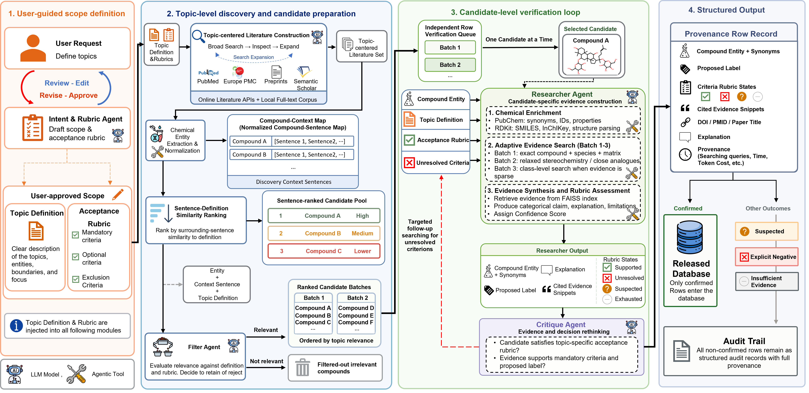

**Supplementary Information**  
DB-Curator: on-demand scientific database construction through rubric-guided deep research

# Contents

|                                             |                                                  |
| :------------------------------------------ | :----------------------------------------------- |
| *System and inputs*                         | Supplementary Fig. 1, Notes 1–6                  |
| *Final databases and evaluation*            | Notes 7–9, Tables 1–5                            |
| *Component ablation and criterion profiles* | Notes 10–12, Supplementary Figs. 2–4, Tables 6–8 |
| *Accepted-record evidence*                  | Note 13                                          |

# Supplementary Figure 1. Detailed DB-Curator workflow

Supplementary Figure 1 Operational workflow. The user and refinement agent define and approve the scientific scope and acceptance rubric, which guide topic-centred literature construction, candidate filtering and row assessment. Chemical mentions form a source-linked compound–context map for sentence–definition ranking and batched handoff. Each candidate is verified independently: the Researcher agent collects evidence and updates criterion assessments, and Critique reviews the interpretation and can request targeted follow-up. The controller uses criterion states, exclusions and the search allowance to stop verification. Released rows require a Confirmed label, an approved decision and source-located evidence.

# Supplementary Note 1. Topic definitions

Each domain was evaluated with an explicit user-approved topic definition, from which the verification rubric was generated.

| Topic                        | User-approved topic scope                                                                                                                                                                                                                                                                                                                                                                      |
| :--------------------------- | :--------------------------------------------------------------------------------------------------------------------------------------------------------------------------------------------------------------------------------------------------------------------------------------------------------------------------------------------------------------------------------------------- |
| DBPs                         | A disinfection by-product is a specific chemical compound formed when disinfectants or oxidants react with natural or anthropogenic precursors in real or simulated water matrices, with direct evidence attributing formation to the treatment process.                                                                                                                                       |
| Blood exposome               | A human blood exposome chemical is a specific chemical entity reported in human blood or systemic circulation that is introduced by, structurally modified by, or significantly changes in amount in response to the external environment, and is supported by evidence from primary literature, biomonitoring surveys, or public metabolomics datasets associated with human blood specimens. |
| Drug compounds               | A drug compound is a core active drug substance or drug entity represented in a drug database, including small-molecule and biologic drugs, that elicits or is intended to elicit pharmacologically relevant effects, while excluding specific finished dosage forms, secondary brand names, and other non-active product-level entries.                                                       |
| Human endogenous metabolites | A human endogenous metabolite is a specific small-molecule metabolite produced within the human body and functioning in biochemical and physiological processes, while excluding exogenous chemicals and microbiota-only metabolites unless they are also produced by host metabolism.                                                                                                         |
| Microbial natural products   | A microbial natural product is a specific chemical metabolite produced by microorganisms, such as bacteria, fungi, or cyanobacteria, curated from peer-reviewed primary scientific literature and supported by sufficient analytical evidence for unambiguous structural assignment, while excluding primary metabolites and non-secondary-metabolite biomolecules.                            |

# Supplementary Note 2. Verification rubrics

Mandatory items specify inclusion requirements, exclusions specify rejection conditions and optional items supply scope guidance. The drug-modality clauses were generated as separate items, which the decision contract treats as one ANY condition (Supplementary Note 12).

| Topic                        | Rubric items                                                                                                                                                                                                                                                                                                                                                                                                                                                                                                                                                                                          |
| :--------------------------- | :---------------------------------------------------------------------------------------------------------------------------------------------------------------------------------------------------------------------------------------------------------------------------------------------------------------------------------------------------------------------------------------------------------------------------------------------------------------------------------------------------------------------------------------------------------------------------------------------------- |
| DBPs                         | **\[mandatory\]** The entity must be a specific chemical compound. **\[mandatory\]** The compound’s formation must occur during a water disinfection or oxidation process. **\[mandatory\]** The formation must result from the reaction of disinfectants or oxidants with naturally occurring or anthropogenic precursors. **\[mandatory\]** The reaction must occur in real or simulated water matrices. **\[mandatory\]** There must be evidence directly attributing the compound’s formation to the treatment process.                                                                           |
| Blood exposome               | **\[mandatory\]** The chemical entity must be reported in human blood or systemic circulation. **\[mandatory\]** The chemical entity must be introduced by, structurally modified by, or significantly change in amount in response to the external environment. **\[mandatory\]** Evidence for the chemical entity’s presence and exposomal origin must be supported by primary literature, biomonitoring surveys, or public metabolomics datasets. **\[mandatory\]** The supporting evidence must be associated with human blood specimens.                                                         |
| Drug compounds               | **\[mandatory\]** The entry represents a specific drug substance or drug entity. **\[mandatory, two clauses\]** The entity is a small-molecule drug. The entity is a biotechnology drug. The decision contract evaluates these as one ANY condition. **\[mandatory\]** The drug substance or entity elicits or is intended to elicit pharmacologically relevant effects. **\[mandatory\]** The entry excludes final commercial drug products. **\[mandatory\]** The entry excludes drug formulations. **\[mandatory\]** The entry excludes drug packages.                                             |
| Human endogenous metabolites | **\[mandatory\]** The entity must be a small molecule. **\[mandatory\]** The entity must be produced within the human body. **\[mandatory\]** The entity must function in human biochemical or physiological processes. **\[mandatory\]** The entity must not be solely an exogenous chemical. **\[mandatory\]** The entity must not be solely a microbiota-only metabolite. **\[optional\]** If a metabolite is produced by both microbiota and host metabolism, it is included.                                                                                                                     |
| Microbial natural products   | **\[mandatory\]** The entity must be a specific chemical compound. **\[mandatory\]** The entity must originate from bacteria, fungi, or cyanobacteria. **\[mandatory\]** The entity’s origin must be supported by peer-reviewed primary scientific literature. **\[mandatory\]** The entity’s structural assignment must be unambiguous. **\[mandatory\]** The unambiguous structural assignment must be supported by sufficient analytical evidence. **\[mandatory\]** The entity must not be a primary metabolite. **\[mandatory\]** The entity must not be a non-secondary-metabolite biomolecule. |

For all five topics, the verification-query template was:

    Decide whether '{{CANDIDATE}}' satisfies the confirmed-topic definition.

# Supplementary Note 3. System prompts

The complete evaluated prompts are supplied verbatim in the accompanying source materials. Their roles within the workflow are summarized below.

| Stage                         | Instruction focus                                                                       |
| :---------------------------- | :-------------------------------------------------------------------------------------- |
| Scope refinement              | Clarify the topic definition, inclusion criteria, exclusions and evidence requirements. |
| Topic literature construction | Build a topic-centred literature set through search, inspection and expansion.          |
| Candidate filtering           | Assess chemical identity and contextual relevance before verification.                  |
| Researcher agent              | Acquire candidate-specific evidence and assess the rubric criteria.                     |
| Critique                      | Review criterion-level reasoning and request targeted follow-up.                        |

# Supplementary Note 4. Retrieval, software and model settings

Online retrieval used PubMed/PMC, Europe PMC, the Semantic Scholar Academic Graph API and optional preprint sources. Offline retrieval used a 6.3-million-paper local corpus with SQLite full-text metadata search and local full-text hydration. PDF conversion used OpenDataLoader, with Docling and pdfminer as fallbacks. Candidate discovery used HunFlair2 for chemical NER with linker-based normalization, and compound grounding used PubChem, RDKit and OPSIN. Evidence search used a session-specific FAISS index with lexical and dense retrieval and reranking.

The Researcher agent and both zero-shot baselines used Gemini 2.5 Flash, while primary Critique used GPT-5-mini. Verification used fixed topic definitions, retrieval settings, triage criteria and sampling seeds. A LangGraph recursion limit of 24 bounded execution, with approval, evidence-limited or negative termination when follow-up stopped adding rubric-relevant evidence.

# Supplementary Note 5. Benchmark resources and identity policy

The DBP evaluation used all 687 curated compounds, and each other topic used 300 fixed-seed sampled records. Identity matching also consulted the maintained online resources where local exports were older.

| Topic                        | Benchmark source                                | Role                                                                                                     |
| :--------------------------- | :---------------------------------------------- | :------------------------------------------------------------------------------------------------------- |
| DBP                          | Systematic DBP curation resource, 687 compounds | Full benchmark verification and construction overlap. <https://pubs.acs.org/doi/10.1021/acs.est.4c13900> |
| Blood exposome               | Blood Exposome Database, July 2023              | 300-row verification set and construction overlap. <https://zenodo.org/records/8140710>                  |
| Drug compounds               | DrugBank structure and vocabulary exports       | 300-row verification set and construction overlap. <https://go.drugbank.com/releases/latest#open-data>   |
| Human endogenous metabolites | HMDB metabolite export and accession records    | 300-row verification set and construction overlap. <https://www.hmdb.ca/downloads>                       |
| Microbial natural products   | Natural Products Atlas export                   | 300-row verification set and construction overlap. <https://www.npatlas.org/download>                    |

Benchmark matches supply known positives for identity recovery and allow benchmark-linked retention to be computed. Interpretation of retained non-overlaps depends on benchmark coverage and the user-approved scope. Separate development checks by C.Z. and B.L. compared selected Confirmed and Explicit Negative Evidence rows against the definitions and rubrics, recording alignment for 333/333 DBP, 99/99 blood-exposome, 234/234 drug, 178/184 endogenous-metabolite and 241/241 microbial-natural-product rows. The evaluation cohorts assessed with system labels hidden from the reviewer are described in Supplementary Note 9.

# Supplementary Note 6. Citation source-traceability rule

Citation audits test whether attributed evidence occurs in the identity-compatible source text. DOI, PMID, PMCID, title or source-path metadata link each instance to a paper. DOI and PMID records require title compatibility, and title-only matching requires at least 0.70 normalized token overlap. Database pages, PubChem lookups and tool records are excluded from numerator and denominator. Exact or format-normalized matching then locates the attributed text. Expert review assesses topic membership and evidence support in the reviewed cohorts (Supplementary Note 9).

The benchmark citation inventory contains 7,647 literature references after excluding database and tool records. Source checks and author adjudication identified 7,624 real scholarly works (99.7%), including two books or chapters, and 23 incorrect references. Attributed text was located for 7,246 instances. Publication existence, title–identifier compatibility and quotation correspondence are recorded separately in the Source Data.

# Supplementary Note 7. Final databases and citation inventories

The benchmark cohort comprises 1,887 assigned candidates. Prediction labels are taken from the last Researcher report, separately from approval and release eligibility. Open-ended construction processed 2,122 candidate records and retained 1,000 distinct entries, 200 per topic. Construction continued through same-topic literature candidate pools until each target was reached. Every retained row has an approved Confirmed release decision, satisfies the release rule and has source-located attributed text for every paper citation. Candidate records, technical outcomes, identity reviews and citation inventories are supplied with the Source Data.

# Supplementary Table 1. Benchmark decisions and citation provenance

| Topic                      | Inputs | Confirmed | References | Real sources | Source-located |
| :------------------------- | -----: | --------: | ---------: | -----------: | -------------: |
| DBP                        |    687 |       330 |      1,897 |        1,878 |          1,810 |
| Blood exposome             |    300 |        68 |        934 |          934 |            894 |
| Drugs                      |    300 |       213 |      1,870 |        1,870 |          1,803 |
| Endogenous metabolites     |    300 |       125 |      2,067 |        2,065 |          1,944 |
| Microbial natural products |    300 |       239 |        879 |          877 |            795 |
| Total                      |  1,887 |       975 |      7,647 |        7,624 |          7,246 |

Final Researcher labels: 975 Confirmed, 664 Insufficient Direct Evidence, 114 Suspected, 108 Explicit Negative Evidence, 14 Out of Scope Matrix or Context and 12 Indirect or Class-Level Only. The 975 Confirmed predictions contain 4,169 literature references, of which 3,964 are source-located. The 23 incorrect reference instances occur in 15 candidates, including 14 with Confirmed predictions. Tool and database records are excluded from the literature denominator.

# Supplementary Table 2. Construction coverage, retention and citation provenance

All 1,000 retained rows have approved Confirmed release decisions and their 7,689 paper citations are source-located. Five database or tool references are excluded from the paper-citation count. The 2,122 processed records comprise 2,093 scientific predictions and 29 technical outcomes without a completed decision. The last Researcher reports contain 1,284 Confirmed predictions, before the separate identity, duplication and release checks. Among the 1,000 retained entries, the Researcher labels are Confirmed for 999 and Suspected for malondialdehyde. For this entry, Critique recorded all five rubric items as solved and approved a Confirmed release decision under the saved adjudication rule. Both labels are preserved in the source record. Matched-identity counts collapse repeated names and acid/conjugate-base forms while preserving stereochemical and isotopic distinctions. Class and congener associations are not counted as exact entity matches. Of the 406 retained entries without an established match, 54 remain identity-review cases and 22 have unresolved lookups. These categories remain visible in the released tables.

Accumulation curves in main-text Figure 2a show how the five databases reach their 200-entry targets in recorded candidate-processing order.

# Supplementary Note 8. Cohorts and endpoints

# Supplementary Table 3. Cohort, endpoint and analysis

| Cohort                     | Units and endpoint                                                                         | Analysis                                                                        |
| :------------------------- | :----------------------------------------------------------------------------------------- | :------------------------------------------------------------------------------ |
| Construction               | ,122 processed records, 1,000 retained, 7,689 source-located paper citations               | Final retention, benchmark identity recovery, provenance (Fig. 2)               |
| Zero-shot construction     | ,000 proposals, 0/991 located citations                                                    | Retrieval-free comparison (Fig. 2)                                              |
| Benchmark verification     | ,887 inputs, 975 Researcher-Confirmed predictions, 7,246 source-located citation instances | Predictions (Fig. 3a) and citations (Supplementary Table 1)                     |
| Expert review              | construction, 250 zero-shot, 1,886 benchmark, 109 construction non-Confirmed               | Topic fit, citation support and processed-pool recall (Figs. 2e and 3b, Note 9) |
| Component ablation         | candidates \(\times\) 3 repeats \(\times\) 4 settings, 317/488/648/673 Confirmed           | Stage contrasts (Fig. 4a–c)                                                     |
| Feedback comparison        | selected candidates in each arm, final Confirmed percentage                                | Decisions and post-fork resource use (Fig. 4d)                                  |
| Criterion profiles         | ,887 structured rows, 975 Researcher-Confirmed predictions                                 | Criterion profiles by prediction (Fig. 5)                                       |
| Accepted-record inspection | finally accepted candidates within 655 trajectories, 11 source-inspected cases             | Fig. 6, Note 13                                                                 |

# Supplementary Note 9. Expert review

Botao Liu assessed topic membership and citation support record by record, with system labels hidden from the reviewer across all four cohorts in Supplementary Table 4. The construction review covered the complete processing pools from five DB-Curator runs stopped at 50 retained entries each. All 109 non-Confirmed candidates from these runs were also reviewed: 72 DBPs, 14 blood-exposome chemicals, one drug, 15 endogenous metabolites and seven microbial natural products. The zero-shot cohort contained 50 proposals per topic. The reviewer assessed the supplied evidence and recorded objections as written comments. Under the reviewer’s annotation convention, entries without a recorded objection were counted as agreement on topic membership and citation support. Written comments and subsequent author clarification were reconciled at the row level, with original annotations and interpretations stored separately. Agreement was summarized against the corresponding archived system decisions after review.

# Supplementary Table 4. Expert review and construction recall

*a, Review cohorts and agreement*

| Cohort                     | Reviewed | Agreement | Disagreement |
| :------------------------- | -------: | --------: | -----------: |
| DB-Curator construction    |      250 |       241 |            9 |
| Zero-shot construction     |      250 |       248 |            2 |
| Benchmark verification     |    1,886 |     1,870 |           16 |
| Construction non-Confirmed |      109 |       107 |            2 |

Within the archived expert-review sets, agreement among outputs labeled Confirmed was 965/976 for benchmark verification and 241/250 for construction. These subgroups were defined after review using archived system labels. They are separate from the final Researcher predictions in main-text Fig. 3a. The blood export contained a duplicated evidence-cell fragment, and one endogenous record lacked a category, giving 1,886 benchmark records. For zero-shot proposals, automated reference matching found an existing reference in ten rows and a content-matched reference in one.

*b, Processed-pool confusion matrices for open-ended construction*

| Topic                     | Processed |  TP | FP | FN |  TN | Precision (%) | Recall (%) |
| :------------------------ | --------: | --: | -: | -: | --: | ------------: | ---------: |
| DBP                       |       122 |  45 |  5 |  0 |  72 |          90.0 |      100.0 |
| Blood exposome            |        64 |  50 |  0 |  2 |  12 |         100.0 |       96.2 |
| Drug                      |        51 |  50 |  0 |  0 |   1 |         100.0 |      100.0 |
| Endogenous metabolite     |        65 |  47 |  3 |  0 |  15 |          94.0 |      100.0 |
| Microbial natural product |        57 |  49 |  1 |  0 |   7 |          98.0 |      100.0 |
| Total                     |       359 | 241 |  9 |  2 | 107 |          96.4 |       99.2 |

The two false negatives were 9-fluorenone and N-Acetylputrescine in the blood-exposome task. Final review clarification classified both as qualifying compounds. For the other 107 non-Confirmed candidates, the reviewer endorsed non-inclusion under the task’s evidence requirements. Precision is TP/(TP+FP), and processed-pool recall is TP/(TP+FN), evaluated on the complete 359-candidate processing pool of these five runs.

# Supplementary Table 5. Reasons for non-acceptance in the construction review

| Review outcome                                       | DB-Curator | Zero-shot |
| :--------------------------------------------------- | ---------: | --------: |
| Class-level entity rather than individual compound   |          5 |         1 |
| Other scope, precursor or isotope-identity objection |          4 |         1 |
| Total not counted as agreement                       |          9 |         2 |

Following reviewer clarification, agreement was recorded for 241/250 construction entries. Five of the nine non-accepted entries were organic class-level names: N-chloroaldimines, Trihalomethanes, chlor(am)ine, selenoamino acids and peptaibols. These entries illustrate the distinction between topic relevance and the requirement to identify an individual database entity. They remain outside the accepted count. Some inorganic entries were approved under the reviewer’s topic-specific interpretation, and naming corrections attached to approved classifications remain in the row-level record.

The four other construction objections concerned oxo8A (precursor rather than DBP), adenine (DBP membership), 6-methylmercaptopurine riboside (drug-metabolite scope) and hexanoic acid-d3 (labelled rather than native compound). The zero-shot count remained 248/250, with Organophosphate Pesticides rejected as class-level and Thapsigargin rejected for microbial-topic membership. Original annotations, clarified decisions and the reconstruction script accompany the source data. Benchmark agreement includes 23 comments confirming that supporting literature was found, as clarified by the authors. The remaining 16 records comprise 11 Confirmed endogenous-metabolite entries with origin or scope objections and five records, labelled Explicit Negative Evidence by the system, whose evidence assessment the reviewer disputed.

# Supplementary Note 10. Repeated component ablation

One hundred candidates were randomly sampled from each topic benchmark, and the same 500 candidates were evaluated three times under four configurations. Stage contrasts compare the same candidate and repeat, averaging within topics before combining the five topic means with equal weight. Errors and timeouts contributed zero yield.

Main-text Figure 4 compares evidence-acquisition stages, repeat consistency, Critique configurations and same-state feedback mechanisms. Supplementary Figure 2 shows resource use in the repeated ablation.

# Supplementary Table 6. Paired contrasts between successive ablation settings

| Topic                      | Contrast        | Difference (pp) |
| :------------------------- | :-------------- | --------------: |
| Overall                    | Full–Adaptive   |            1.67 |
| Overall                    | Adaptive–Frozen |           10.67 |
| Overall                    | Frozen–Zero     |           11.40 |
| DBPs                       | Full–Adaptive   |            3.00 |
| DBPs                       | Adaptive–Frozen |           28.00 |
| DBPs                       | Frozen–Zero     |      \(-10.67\) |
| Blood exposome             | Full–Adaptive   |            0.00 |
| Blood exposome             | Adaptive–Frozen |            4.33 |
| Blood exposome             | Frozen–Zero     |           11.33 |
| Drugs                      | Full–Adaptive   |            0.33 |
| Drugs                      | Adaptive–Frozen |            0.67 |
| Drugs                      | Frozen–Zero     |           15.00 |
| Endogenous metabolites     | Full–Adaptive   |            3.33 |
| Endogenous metabolites     | Adaptive–Frozen |            6.67 |
| Endogenous metabolites     | Frozen–Zero     |       \(-3.67\) |
| Microbial natural products | Full–Adaptive   |            1.67 |
| Microbial natural products | Adaptive–Frozen |           13.67 |
| Microbial natural products | Frozen–Zero     |           45.00 |

# Supplementary Table 7. Yield and resource use in the repeated ablation

| Condition       | Confirmed | Token \(n\) | Mean tokens | Time \(n\) | Mean seconds |
| :-------------- | --------: | ----------: | ----------: | ---------: | -----------: |
| Zero-shot       | 317/1,500 |       1,499 |         518 |          – |            – |
| Static RAG      | 488/1,500 |       1,500 |       3,871 |      1,500 |        29.03 |
| Adaptive search | 648/1,500 |           – |           – |          – |            – |
| Full DB-Curator | 673/1,500 |       1,500 |     232,118 |      1,500 |       271.10 |

Each configuration was evaluated on the same 500 candidates across three repeats, giving 1,500 decisions per configuration. Repeat consistency compares each candidate’s three decisions, and the Critique-model comparison pairs the two configurations on the same candidate and repeat. Resource summaries describe the executions underlying the reported decisions. Adaptive search is the pre-Critique state within Full and was not separately metered.

# Supplementary Figure 2. Yield and resource use in the repeated ablation

**Supplementary Figure 2 Computational investment across evidence-acquisition settings.** Confirmed fraction against mean recorded tokens per candidate on a logarithmic scale, using the same 500 candidates in three repeats. Tokens were recorded for 1,499 zero-shot, 1,500 frozen-retrieval and 1,500 Full observations. Mean runtime was 29.03 s for frozen retrieval and 271.10 s for Full, recorded for 1,500 and 1,500 observations, respectively. Resource summaries describe measured consumption for each configuration (Supplementary Table 7). Repeat consistency and Critique-model comparisons appear in main-text Fig. 4a,c.

# Supplementary Figure 3. Runtime by topic in benchmark verification

**Supplementary Figure 3 Runtime distributions across the five topics.** Violin plots show recorded runtime on a logarithmic scale, with medians (points) and interquartile ranges (lines). The analysis includes 1,887 benchmark candidates, comprising 687 DBPs, 300 blood-exposome chemicals, 300 drugs, 300 endogenous metabolites and 300 microbial natural products. Decision-specific token distributions and the token–runtime relationship appear in main-text Fig. 3c,d.

Within the 1,887-candidate benchmark cohort, resource analyses use 1,887 complete token measurements, 1,887 runtime measurements and 1,887 paired observations. In the token analysis, 912 non-Confirmed outcomes consumed 385,777,703 tokens (66.7%), whereas 975 Confirmed predictions consumed 192,606,518 tokens (33.3%). Median token use was higher for non-Confirmed outcomes in every topic. Repeated research–review cycles were counted when a candidate reached Critique more than once in its recorded trajectory. This occurred in 647/912 non-Confirmed evaluations (70.9%) and 326/975 Confirmed evaluations (33.4%).

# Supplementary Note 11. Sensitivity to structured-output selection

A chronological extraction of Researcher agent labels from the original archived executions tested the sensitivity of the Full–Adaptive difference to saved-stage selection. The comparison used the last complete Researcher agent output before the first Critique call and the last output overall. Table 8 compares strict extraction with syntax-normalized extraction.

# Supplementary Table 8. Archived-run Full–Adaptive contrast under alternative label extraction

| Eligibility | Labels        | Pairs | Pre / post | Up / down | Net pp |
| :---------- | :------------ | ----: | ---------: | --------: | -----: |
| All planned | Saved         |  1500 |  645 / 671 |    35 / 9 |   1.73 |
| Strict      | Saved         |  1393 |  642 / 661 |    28 / 9 |   1.36 |
| Strict      | Chronological |  1393 |  659 / 671 |   30 / 18 |   0.86 |
| Recovered   | Saved         |  1422 |  642 / 664 |    31 / 9 |   1.55 |
| Recovered   | Chronological |  1422 |  663 / 677 |   32 / 18 |   0.98 |

Observed net changes range from 0.86 to 1.73 percentage points across extraction rules. The source tables retain chronological label bindings, exclusions and discrepant saved states.

# Supplementary Note 12. Criterion profiles and acceptance semantics

**Supplementary Figure 4 Complete criterion-indicator profiles across five rubrics.** All 28 criteria are shown, ordered within each topic by the difference between Confirmed and other outcomes. Recorded criterion indicators denote items marked solved or scored at least 0.5, irrespective of supporting or disqualifying direction. Blue circles show Confirmed frequencies, open red diamonds show other-outcome frequencies, and the right column gives the difference in percentage points. Topic headers report the corresponding record counts. M, X and O denote mandatory, exclusion and optional roles. Drug modality uses an either-branch summary. Main-text Fig. 5 shows representative criteria alongside the row-level indicator distributions.

Criterion profiles use the final recorded rubric states for all 1,887 benchmark candidates and the same decisions as Fig. 3a. An item contributes a recorded criterion indicator when marked solved or scored at least 0.5. Indicators summarize assessments of both inclusion and exclusion criteria, with resolved exclusions potentially representing disqualifying evidence.

Drug modality is one mandatory ANY condition: support for either the small-molecule or biotechnology branch satisfies the modality requirement. The blood-exposome profile includes its mandatory environmental-relation criterion. Final acceptance requires recorded evidence support for every applicable mandatory criterion, with exclusion-trigger propositions evaluated in their stated direction.

# Supplementary Note 13. Evidence completeness in finally accepted records

The 655 completed trajectories contained 142 candidates with a final Confirmed decision and acceptance flag. Eleven of these candidates had source-linked diagnostic inspections. We retained all 11 and compared their initial and subsequent evidence against the relevant criteria.

For 4-hydroxybenzene-1,2-dicarboxylic acid, the initial quote established chlorination formation. Review requested the missing precursor connection. The response added a located sentence from the same abstract describing the compounds as intermediates between natural organic matter and halogenated products (DOI: `10.1021/acs.est.9b06403`). The candidate remained Confirmed, but its evidence more explicitly addressed the precursor requirement.

For Isoterrelumamide A, the primary isolation paper already supported fungal origin and NMR/HRESIMS structure determination. Review requested explicit secondary-metabolite support. The subsequent report added literature naming the compound within that context, again without changing the Confirmed label.

For 2,2-dichloropropionic acid, an analytical-panel mention was supplemented with a study comparing source and treated water. The latter reported 0.1–0.5 micrograms per litre in potable water and less than 0.01 micrograms per litre in source water. The study interpreted the pattern as suggesting in situ formation.

The same inspection also found unresolved links in accepted records. Evidence for related phosphatidylcholine species did not establish the exact target PC(20:2(11Z,14Z)/20:1(11Z)). Factor IX Complex (Human) was not reconciled with evidence about the individual factor IX protein. Other records retained questions about specimen, formation or formulation scope. The inspections identify the criterion-specific relationships established or left unresolved by each passage. All 11 records, their source anchors and the unresolved questions are supplied in the Source Data.
